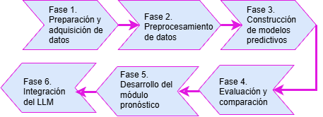
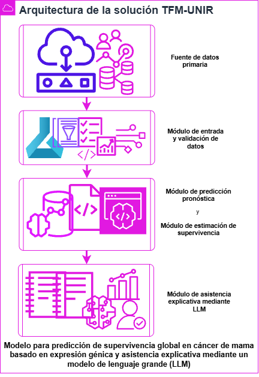

# Máster Universitario en Bioinformática - TFE
## Desarrollo de un modelo para predicción de supervivencia global en cáncer de mama basado en expresión génica y asistencia explicativa mediante un modelo de lenguaje grande (LLM)
Este trabajo es una propuesta computacional para la predicción de supervivencia global de personas con cáncer de mama, a partir de datos de expresión génica. Se obtiene una metodología reproducible que permite estudiar el valor de la información molecular y clínica para la predicción pronóstica, complementado con el uso de LLM como herramienta explicativa.

El procedimiento metodológico se estructuró en varias etapas: obtención e integración de los datos, preparación de la matriz de expresión génica, construcción de las variables de supervivencia, división de los datos en conjuntos de entrenamiento y prueba, entrenamiento y evaluación de los modelos, implementación del módulo de predicción y desarrollo del componente de asistencia explicativa y técnicamente se presenta en 6 fases.

1. Consultamos la base de datos [The Cancer Genome Atlas (TCGA)](https://portal.gdc.cancer.gov/projects/TCGA-BRCA) donde se encuentra la información o los datos usados en el proyecto.
2. Otra fuente [TCGA BRCA cancer dataset](https://zenodo.org/records/4309168)
 
3. Se decidió la siguiente arquitectura para la solución

# Flujo de Trabajo en R para el análisis de los datos y la programación de los modelos de Machine Learning están en la carpeta  [src](/src/)
El flujo de trabajo integra **Python** y **R** para el análisis y desarrollo.

  

## Trabajo de Fin de Estudios

### Bioinformáfica:
|Presentado por:  |
|--|
| Ing. Deivis Martínez A.|

